### Hi, I'm Piotr 👋

I build mobile apps, web platforms and embedded things. Mostly Flutter, Next.js and Python.

  <a href="https://github.com/KNI-PM-Szczecin/plan_pm"></a>
  <a href="https://apps.apple.com/us/app/until-done/id6752790841"></a>

  
  <a href="https://github.com/Schoji/voice-assistant-v2"></a>

  <a href="https://github.com/Schoji/gcodec">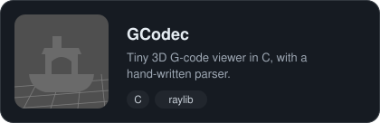</a>
  

  <a href="https://github.com/Schoji/esp32cam-doorbell"></a>
  <a href="https://piotrwittig.com/projects/kanarradar"></a>

  <a href="https://github.com/KNI-PM-Szczecin/NavigatorPM"></a>
  

  <a href="https://github.com/Schoji/horouge"></a>
  <a href="https://github.com/Schoji/SoundNest">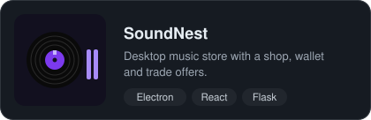</a>

  <a href="https://skillicons.dev">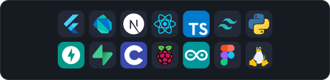</a>
  <a href="https://piotrwittig.com">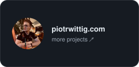</a>

